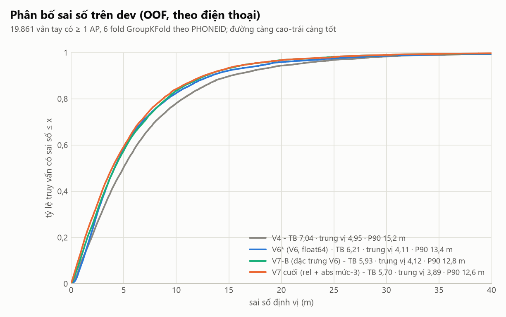
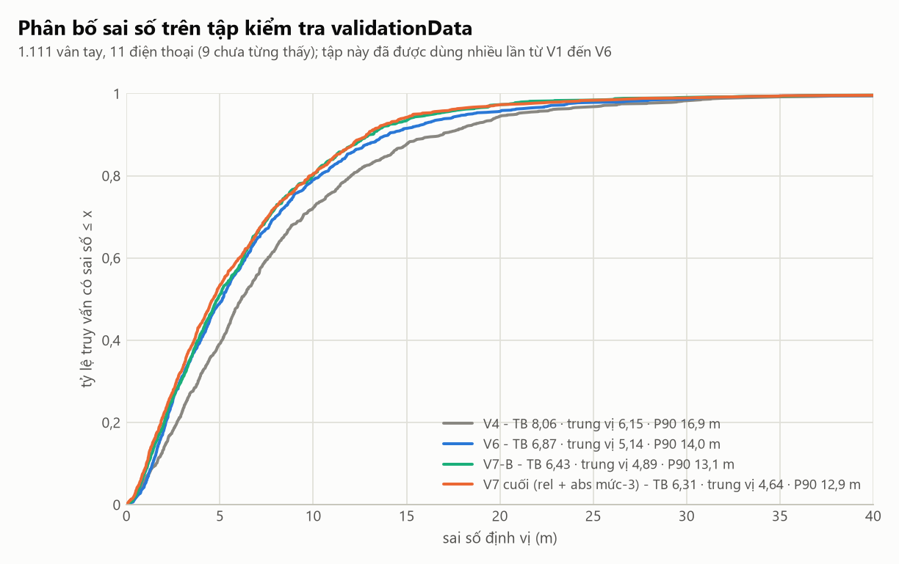

# HUIM-IPS V7 — Báo cáo nghiên cứu: giảm sai số định vị bằng bằng chứng HUI, không dùng k-NN

**Kết luận ngắn.** Mục tiêu "dưới 6,00 m trên UJIIndoorLoc" **chưa đạt**. Mô hình V7 tốt nhất theo dev (V7-C2) cho
**6,31 m** trên `validationData.csv` (V6: 6,86 m; giảm 0,55 m, 8,1%) và **5,70 m** trên các fold dev out-of-fold của
`trainingData.csv` (V6: 6,21 m) khi chỉ tính vân tay có ít nhất một AP. Mọi con số dưới đây đọc từ tệp trong
`results/huim_only/uji/v7/` và `BAOCAO_V7/so_lieu/`; chạy lại bằng `python src/v7/run_v7.py`.

---

## 1. Bài toán, mục tiêu và ràng buộc

HUIM-IPS V6 định vị bằng cách khai thác tập mục lợi ích cao (HUI) bằng EFIM cho từng ô tham chiếu, chọn tầng và 30 ô
ứng viên từ bằng chứng HUI, rồi xếp hạng lại 30 ô bằng Gradient Boosting học từ các đặc trưng sinh ra từ HUI. V6 đạt
6,87 m (báo cáo; 6,86 m khi tái tạo ở đây) trên 1.111 vân tay kiểm tra, đúng tầng 80,4%. Mục tiêu của V7 là kéo sai số
trung bình xuống dưới 6,00 m (tốt hơn nếu 5,5–5,8 m), **giữ nguyên** các ràng buộc: HUIM là lõi (EFIM tạo HUI, tòa/tầng/ô
ứng viên đều từ HUI); không k-NN/WKNN, không mô hình học máy độc lập trên RSSI thô; mô hình phụ chỉ nhận đặc trưng sinh
từ HUI; không lưu vân tay huấn luyện để so khớp; không rò rỉ giữa train/dev/test; không chỉnh số liệu; V6 phải còn chạy
lại được.

## 2. Vấn đề của V6 — chẩn đoán trên dữ liệu thật

Chẩn đoán dùng dự đoán out-of-fold của V6 trên 6 fold dev (GroupKFold theo `PHONEID`, 16 điện thoại); nhãn thật chỉ để
**đo**, không bao giờ làm đặc trưng. Chi tiết: [`KIEM_TOAN_V6.md`](KIEM_TOAN_V6.md); bảng: `results/huim_only/uji/v7/diagnosis/`.

**(a) HUI không chọn sai vùng; sai số sinh ra ở khâu xếp hạng và kết hợp ô.** Trên 19.861 vân tay có thông tin:

| Nguồn tọa độ | sai số TB (m) | % truy vấn dưới 3 m | dưới 5 m | dưới 10 m |
|---|---|---|---|---|
| ô điểm HUI cao nhất | 7,52 | 32,7 | 48,1 | 73,1 |
| tọa độ hợp nhất cuối của V6 | 6,21 | 37,1 | 58,3 | 82,5 |
| ô gần nhất trong 30 ứng viên (tiên tri, dùng nhãn thật) | **0,59** | **92,4** | **95,9** | **99,0** |

Trong 30 ô ứng viên gần như luôn có ô rất gần vị trí thật; V6 không tận dụng được điều đó. Với 10% truy vấn tệ nhất
(≥ 13,3 m), chiếm 35,2% tổng sai số, ô gần nhất trong 30 ứng viên vẫn chỉ cách 2,27 m. Đây là lý do V7 nhắm vào
**cách chấm điểm và kết hợp các ô**, không nhắm vào việc tìm thêm ứng viên.

**(b) Tầng.** Đúng tầng 84,2% (dev). Đúng tầng: 5,62 m (16.714 truy vấn); sai tầng: 9,35 m (3.147 truy vấn); nhóm sai tầng
chiếm 23,8% tổng sai số. Trên validationData: đúng tầng 80,4%; 6,48 m (893) so với 8,44 m (218) — đúng như báo cáo V6.

**(c) Hai khiếm khuyết đo lường của V6** (không phải lỗi thuật toán định vị, nhưng làm số liệu sai lệch):

1. **76 vân tay huấn luyện không phát hiện AP nào** (điện thoại 1: 59, 22: 14, 13: 2, 6: 1). Mọi ô điểm 0, vị trí là kết quả
   hòa điểm tùy ý; sai số trung bình **180,5 m**, chiếm **10,0% tổng sai số dev**. Gộp chúng vào, dev của V6 là 6,879 m;
   bỏ ra, 6,215 m. `validationData.csv` có **0** vân tay như vậy. Vì vậy V7 báo cáo **hai** cách tính (tất cả 19.937;
   có thông tin 19.861) và dùng cách thứ hai để chọn mô hình, với lý do: hành vi trên đầu vào không mang thông tin
   không phải thứ cần tối ưu và không xuất hiện ở tập kiểm tra. Mọi kết luận dưới đây giữ nguyên ở cả hai cách tính.
2. **Nhiễu số học float32.** Trọng số float32 có tổng lệch ~1e-7; nhân với tọa độ Web-Mercator ~4,9·10⁶ làm tâm lệch
   0,5–1 đơn vị tọa độ. V7 tính tâm bằng float64 và tọa độ tương đối (V6*: 6,2148 → 6,2087 m).

## 3. Cơ sở đề xuất V7

Từ (a): đặt lại bài toán thành **chọn trọng số trên 30 ứng viên sao cho tọa độ hợp nhất sai ít nhất**, thay vì dự đoán
từng khoảng cách ô rồi đổi thành trọng số bằng công thức cố định. Dự đoán khoảng cách từng ô tốt không bảo đảm tọa độ
hợp nhất tốt. Từ lịch sử V6 (thêm một góc nhìn HUI mới — mô hình abs — giảm 0,26 m): **đa dạng hóa bằng chứng HUI** là đòn bẩy
mạnh; V6 chưa dùng lợi ích nội `rel` dù mô tả nó là lợi ích bất biến với độ lệch thu của điện thoại.

## 4. Phương pháp V7

```
EFIM → HUI của từng ô ở 5 góc nhìn (rank, rank-mức-3, abs, rel, abs-mức-3; 12,9 triệu HUI)
   → điểm khớp HUI mọi ô → tầng (như V6) → 30 ô ứng viên của tầng
   → 33 đặc trưng V6 + 8 đặc trưng/mô hình bổ sung (P, V, R, điểm tương đối, hạng, MAE/corr/cos của hồ sơ cường độ HUI)
   → bộ chấm điểm dùng chung s_i → w = softmax(s) → (x, y) = Σ w_i c_i
```

### 4.1 Công thức

* **Điểm khớp HUI của ô c** (V6, giữ nguyên): P_c(T) = Σ_X w(X)·frac(X,T)^γ·exp(−|q_T(X)−q̄_c(X)|/τ) với
  w(X)=u(X)/Σ_Y u(Y), V_c(T) = độ phủ của truy vấn bởi các AP trong HUI của ô, S_c = P_c·V_c³ rồi làm mượt Gaussian
  σ = 3 m trong cùng tầng; γ=2, τ=20, θ=20%.
* **Đặc trưng tương đối:** mỗi đặc trưng x của ứng viên i được thêm x_i − max_j x_j, x_i min-max trong truy vấn, và
  hạng của x_i; sau đó log có dấu sign(x)·log(1+|x|) và chuẩn hóa z-score.
* **Trọng số và tọa độ:** w_i = exp(s_i)/Σ_j exp(s_j); x̂ = Σ_i w_i x_i, ŷ = Σ_i w_i y_i (tâm ô c_i = (x_i, y_i), tính
  bằng float64 so với ô ứng viên số 1).
* **Mất mát (đúng như đề bài):** L = (1/N) Σ_n 0,766126 · √((x̂−x)² + (ŷ−y)² + ε), ε=1e-6.
* **Bộ chấm điểm:** MLP nhỏ dùng chung cho mọi ứng viên: h = ReLU(W₁x+b₁) (32 đơn vị); ghép [h, trung bình h trên 30 ứng
  viên] (nhánh gộp cho phép điểm của một ô phụ thuộc các ô còn lại của cùng truy vấn); ReLU(W₂·+b₂) (16 đơn vị);
  s = w₃·h₂. Tổng cộng 5.312 tham số (V7-B: 132 đầu vào = 33 đặc trưng × 4 phép tương đối) đến 7.360 (V7-C2: 196 đầu vào = 49 đặc trưng × 4). Gradient viết tay bằng NumPy và kiểm bằng sai
  phân hữu hạn (sai lệch tương đối 5·10⁻⁸; `tests/test_v7.py`). Adam, lr 5·10⁻⁴, weight decay 10⁻³, batch 256, tối đa 30 epoch.
* **Tập hợp chéo (cross-fitted ensemble):** với mỗi fold đánh giá, 5 thành viên; thành viên i dừng sớm trên fold huấn
  luyện i và huấn luyện trên 4 fold còn lại; điểm s trung bình rồi softmax. Fold đánh giá không bao giờ được thấy.

### 4.2 Các thí nghiệm

**V7-A — hợp nhất thích ứng** (`fusion.py`, trên dự đoán khoảng cách của bộ xếp hạng V6): số ô linh hoạt (cắt theo
chênh lệch d̂−d̂_min), nhiệt độ softmax thích ứng T = T₀(1 + c·d̂_min), loại ô điểm HUI thấp (S/S_top1 < s_min), và chọn
cụm (bán kính r quanh ô có khối lượng softmax lớn nhất). Tham số chọn kiểu lồng nhau: chọn trên 5 fold, đo trên fold còn lại.

**V7-B — tối ưu tọa độ trực tiếp** (`direct.py`): bộ chấm điểm ở §4.1 chỉ với 33 đặc trưng V6.

**V7-C — bằng chứng HUI bổ sung:** (C1) thêm mô hình HUI trên lợi ích `rel`; (C2) thêm mô hình HUI trên (AP, mức cường độ
tuyệt đối), 3 mức. Mỗi mô hình bổ sung cho 8 đặc trưng mỗi ứng viên (`extra_models.py`). Hai khối đặc trưng thử thêm
bị **loại** vì không có lợi ở dev: khối "bù lệch thiết bị" (`device.py`: độ lệch ngụ ý của ô, MAE sau khi trừ độ lệch, chênh lệch RSSI
tương đối của các AP mạnh nhất, khối lượng AP then chốt vắng mặt, độ ổn định support, mức nhất quán giữa 3 mô hình) và khối
"đồng thuận không gian" (`geo.py`: khoảng cách tới trọng tâm bằng chứng và mật độ bằng chứng của từng mô hình).

**V7-D — HUI phân cấp** (`hier.py`): xem §6.9.

### 4.3 HUIM vẫn là lõi — bằng chứng

* Tập ứng viên, tầng và mọi đặc trưng đều tính từ HUI do EFIM khai thác (hàm `compute`, `extra_block`) và từ tọa độ tâm ô.
  Đầu vào duy nhất ngoài HUI là chính vân tay truy vấn, và nó chỉ được dùng để **khớp với HUI** (P, V, R, hồ sơ cường độ q̂ suy
  ra từ HUI).
* Mô hình lưu trữ chỉ gồm HUI (tập mục, u, support) và vị trí/tầng của ô, 5 tệp `.npz`; không có vân tay huấn luyện nào.
* Không có phép tìm láng giềng: test `test_no_knn_or_raw_fingerprint_matching_in_v7_positioning_code` và kiểm chứng T12 quét
  cây cú pháp 9 mô-đun suy luận, không thấy `KNeighbors`, `NearestNeighbors`, `KDTree`, `BallTree`, `cdist`, `pairwise_distances`.
* EFIM khai thác **chính xác**: bộ test có sẵn `tests/test_efim.py` (85 đạt, 1 bỏ qua) so EFIM với duyệt vét cạn, thêm 1 test mới
  chạy EFIM và duyệt vét cạn trên giao dịch của ô thật (11 AP phổ biến nhất): cùng HUI, cùng lợi ích, cùng support. Số HUI của 12 mô hình fold bằng đúng số
  trong kết quả V6.
* Tọa độ thật chỉ xuất hiện làm nhãn huấn luyện và đo lường.

## 5. Giao thức thực nghiệm

* **Fold:** `GroupKFold(6)` theo `PHONEID`, đúng như V6; mô hình HUI của fold k đào chỉ trên các điện thoại khác (assert trong
  `dev_features.py`; T10 kiểm lại băm chỉ số hàng).
* **Cache có nguồn gốc:** mỗi cache ghi SHA-256 của `trainingData.csv`, băm chỉ số hàng huấn luyện/đánh giá của fold, phiên bản
  mã, seed, cấu hình; `load_cache` từ chối cache không khớp (test `test_cache_metadata_is_enforced`).
* **Chọn mô hình chỉ bằng dev OOF.** Danh sách biến thể được khai báo trước khi chạy test; mỗi biến thể chấm đúng một lần
  trên `validationData.csv`, **kể cả biến thể không được chọn** (bảng §6.2). Tập này đã được dùng nhiều lần từ V1 đến V6 nên
  các số trên đó là chỉ báo độc lập chưa hoàn toàn; chưa có tập kiểm tra mới.
* **Khoảng tin cậy:** bootstrap theo cụm `PHONEID` (4.000 lần lấy mẫu lại cả điện thoại, có hoàn lại); chênh lệch cặp dùng
  cùng tập cụm được lấy mẫu cho hai mô hình. Dev có 16 cụm, test có 11 cụm (điện thoại 13 chiếm 33% vân tay), nên khoảng
  tin cậy của trung bình rộng; khoảng tin cậy của **chênh lệch cặp** hẹp hơn nhiều và là thứ cần đọc.
* **Seed/tái lập:** seed 0; hai lần chạy độc lập của cùng cấu hình cho sai số theo fold trùng đến 3 chữ số thập phân
  (kiểm chứng T14). Mọi tham số có cấu hình đầy đủ ở `cau_hinh/v7_config.json` và `configs/v7.yaml`.
* **Rò rỉ gián tiếp bậc hai** của giao thức OOF chuẩn (§6.8) được đo riêng.

## 6. Kết quả

### 6.1 Dev (out-of-fold, 6 fold theo điện thoại)

Sai số trung bình (m); khoảng tin cậy 95% theo cụm điện thoại cho chênh lệch cặp so với V6\*.

| Mô hình | Có thông tin (19.861) | Chênh vs V6\* [KTC 95%] | Tất cả (19.937) | Trung vị | P75 | P90 |
|---|---|---|---|---|---|---|
| V4 | 7,039 | +0,830 [+0,698; +0,955] | 7,677 | 4,954 | 9,157 | 15,181 |
| V5 (tái tạo) | 6,449 | +0,240 [+0,126; +0,358] | 7,100 | 4,374 | 8,098 | 13,865 |
| V6 (như công bố, float32) | 6,215 | +0,006 [−0,004; +0,011] | 6,879 | 4,121 | 7,843 | 13,315 |
| **V6\*** (V6, float64) | **6,209** | — | 6,873 | 4,114 | 7,857 | 13,383 |
| V7-A hợp nhất thích ứng (lồng nhau) | 6,181 | −0,027 [−0,090; +0,008] | 6,821 | 4,143 | 8,023 | 13,650 |
| V7-B tối ưu trực tiếp | 5,930 | −0,279 [−0,464; −0,110] | 6,536 | 4,122 | 7,884 | 12,786 |
| V7-C1 + HUI rel | 5,735 | −0,474 [−0,689; −0,268] | 6,338 | 3,948 | 7,572 | 12,614 |
| **V7-C2 + HUI abs mức-3 (chọn)** | **5,702** | **−0,507 [−0,734; −0,261]** | **6,301** | **3,894** | **7,488** | **12,616** |
| V7-D V7-C2 + ngữ cảnh HUI cấp tầng (không chọn) | 5,688 | −0,520 [−0,748; −0,286] | 6,287 | 3,907 | 7,447 | 12,589 |
| V7-C + bù lệch thiết bị (không chọn) | 5,994 | −0,215 [−0,398; −0,048] | 6,601 | 4,107 | 7,834 | 12,996 |

(Độ chính xác tầng dev 84,15%, tòa 99,99% — như nhau ở mọi dòng vì cùng quy tắc chọn tầng.) V7-C2 giảm **0,507 m (8,2%)**;
trong 4.000 lần lấy mẫu lại điện thoại, V7-C2 tốt hơn V6\* ở 99,98%. Mô hình được chọn theo tiêu chí "sai số dev thấp hơn và tốt hơn ở ít nhất 4/6 fold" (xem §6.9): V7-C2. Chênh lệch C2 − C1 chỉ 0,034 m
(KTC cặp [−0,087; +0,054], C2 tốt hơn ở 4/6 fold), nên giá trị riêng của mô hình abs mức-3 nhỏ và **chưa có ý nghĩa thống kê** trên dev (trên test: −0,083 m).

### 6.2 Tập kiểm tra validationData (1.111 vân tay, 11 điện thoại)

Mỗi biến thể được chấm đúng một lần; số của V4/V5/V6 gốc lấy từ dự đoán đã lưu của chúng.

| Mô hình | TB (m) | KTC 95% (cụm điện thoại) | Chênh vs V6 [KTC 95%] | Trung vị | P75 | P90 | P95 | Tầng | Tòa |
|---|---|---|---|---|---|---|---|---|---|
| V4 (lưu) | 8,059 | [7,00; 9,59] | +1,193 | 6,151 | 10,719 | 16,946 | 20,913 | 80,38% | 99,91% |
| V5 (lưu) | 7,178 | [6,25; 8,56] | +0,312 | 5,392 | 9,494 | 14,309 | 19,531 | 80,38% | 99,91% |
| V6 (lưu) | 6,866 | [5,96; 8,21] | — | 5,140 | 8,943 | 14,018 | 18,418 | 80,38% | 99,91% |
| V6 (tái tạo) | 6,861 | [5,95; 8,20] | −0,004 [−0,042; +0,022] | 5,044 | 8,876 | 14,103 | 18,957 | 80,38% | 99,91% |
| V7-A | 6,886 | [5,97; 8,23] | +0,020 [−0,033; +0,082] | 5,007 | 9,043 | 14,345 | 19,129 | 80,38% | 99,91% |
| V7-B | 6,430 | [5,76; 7,42] | −0,436 [−0,836; −0,095] | 4,890 | 8,539 | 13,064 | 16,486 | 80,38% | 99,91% |
| V7-C1 | 6,393 | [5,70; 7,37] | −0,473 [−0,941; −0,053] | 4,763 | 8,557 | 12,965 | 16,546 | 80,38% | 99,91% |
| **V7-C2 (chọn theo dev)** | **6,309** | **[5,65; 7,21]** | **−0,557 [−1,103; −0,149]** | **4,636** | **8,615** | **12,853** | **15,574** | 80,38% | 99,91% |
| V7-D (V7-C2 + HUI cấp tầng; không chọn) | 6,324 | [5,65; 7,24] | −0,542 [−1,084; −0,120] | 4,660 | 8,568 | 12,832 | 15,879 | 80,38% | 99,91% |

V7-C2 trong 99,5% lần lấy mẫu lại điện thoại tốt hơn V6. Đúng tầng (893): 6,476 → **5,859 m** (−0,617); sai tầng (218):
8,440 → 8,154 m (−0,286). Tỷ lệ truy vấn sai số ≤ 2 m: 18,3% → 22,1%; ≤ 5 m: 49,5% → 53,3%.

**Đánh giá mục tiêu:** 6,309 m > 6,00 m, nên **mục tiêu dưới 6 m chưa đạt** trên validationData. Trên dev OOF (vân tay có
thông tin) V7-C2 đạt 5,70 m, nằm trong vùng 5,5–5,8 m, nhưng tập kiểm tra khó hơn dev khoảng 0,6 m ở mọi phiên bản (V6: 6,86 so
với 6,21; V7-C2: 6,31 so với 5,70) vì gồm 9 điện thoại chưa từng thấy và cách thời điểm huấn luyện 4 tháng; khoảng cách này
không do V7 gây ra và V7 không thu hẹp nó (dev −0,51 m, test −0,56 m).

### 6.3 Cắt bỏ thành phần (ablation, dev, vân tay có thông tin)

| Bước | Sai số TB (m) | Thay đổi | Ghi chú |
|---|---|---|---|
| V6 như công bố (float32) | 6,215 | | |
| → tính trọng số float64 (V6\*) | 6,209 | −0,006 | sửa nhiễu số học |
| → V7-A hợp nhất thích ứng | 6,181 | −0,027 | chọn lồng nhau; **không bền trên test** (+0,020) |
| → V7-B tối ưu trực tiếp (thay GBM + công thức cố định) | 5,930 | −0,251 so với V7-A | cắt: 1 thành viên 5,959; tập hợp + log có dấu 5,930 |
| → + HUI rel | 5,735 | −0,195 | |
| → + HUI abs mức-3 | 5,702 | −0,034 | KTC cặp [−0,087; +0,054] |
| → + HUI cấp tầng (V7-D) | 5,688 | −0,013 | trung tính (§6.9) |

Thử trên nền C1 (rel): + đồng thuận không gian = 5,729 (−0,006, không có ý nghĩa, loại). Thử trên nền V6: + bù lệch
thiết bị = 5,994 vs V7-B 5,930 (+0,063, **tệ hơn**, loại). Trộn trọng số của V7-C2 với trọng số GBM của V6 (α, T chọn lồng nhau)
= 5,706, không tốt hơn V7-C2 thuần (5,702). Các lần chạy thăm dò (1 thành viên, MLP 64/32, thêm mất mát phụ listwise 0,3)
nằm ở `so_lieu/exploration_runs.csv`: 5,980 · 6,011 · 5,959; mất mát phụ không giúp.

### 6.4 Tầng

Quy tắc chọn tầng của V6 được giữ nguyên nên độ chính xác tầng/tòa không đổi (dev 84,15%; test 80,38%). Sai số theo tầng
của V7-C2 (dev, vân tay có thông tin): đúng tầng 5,618 → 5,079 m (−9,6%); sai tầng 9,345 → 9,008 m (−3,6%). Phần giảm
chủ yếu đến từ nhóm đúng tầng, phù hợp với việc V7 cải thiện cách kết hợp ô chứ không sửa quyết định tầng.

### 6.5 Theo điện thoại

Dev: V7 tốt hơn V6\* ở 12/16 điện thoại (nhiều nhất: điện thoại 10 giảm 2,21 m; 3: 1,16 m; 11: 0,91 m; 8: 0,83 m; 14: 0,82 m);
không tốt hơn ở điện thoại **17 (+0,59 m, tệ hơn)**, 19 (+0,29), 16 (+0,09), 24 (+0,02). Test: tốt hơn ở 10/11 điện thoại
(điện thoại 14: −2,84 m; 20: −1,46 m; 21: −1,07 m) và tệ hơn ở điện thoại **2** (n=52: 5,70 → 7,02 m, +1,32 m). Điện
thoại 17 (sai số lớn nhất ở dev, 12,5–13,1 m) và 19 (7,9–8,2 m) là hai điện thoại khó mà V7 không giúp được; điện thoại 2 ở test
chỉ có 52 vân tay, nên chênh lệch của nó có độ bất định lớn.
Bảng: `so_lieu/dev_by_phone.csv`, `so_lieu/test_by_phone.csv`; hình F4, F10.

### 6.5b Theo hình học vị trí (đầu hành lang / biên, vùng thưa điểm tham chiếu)

Phân tích dùng vị trí thật chỉ để **phân nhóm** (`src/v7/position_type.py`): với mỗi truy vấn lấy các ô cùng tầng trong 8 m quanh vị trí thật; nếu các ô chỉ nằm ở một phía
(khoảng trống góc lớn nhất ≥ 180°) thì vị trí là **biên / đầu hành lang**, nếu không có ô nào trong 8 m thì là **vùng thưa**.

| Nhóm | % truy vấn (dev / test) | đúng tầng (dev / test) | Dev: V6\* → V7 (m) | Test: V6 → V7 (m) |
|---|---|---|---|---|
| bên trong (ô ở mọi phía) | 50,0% / 44,0% | 91,0% / 86,1% | 5,339 → 4,951 | 5,924 → 5,399 |
| biên / đầu hành lang | 48,6% / 53,0% | 78,4% / 77,6% | 6,969 → 6,355 | 7,277 → 6,721 |
| vùng thưa (không ô nào trong 8 m) | 1,4% / 3,0% | 37,4% / 45,5% | 10,991 → 9,971 | 13,499 → 12,449 |

Đầu hành lang và biên chiếm khoảng một nửa số truy vấn, sai số cao hơn bên trong ~1,6 m ở dev và ~1,4 m ở test, và chọn tầng cũng kém hơn; V7 giảm sai số ở cả ba nhóm
(giảm nhiều nhất ở biên: −0,61 m dev, −0,56 m test). Vùng thưa điểm tham chiếu là nhóm xấu nhất ở mọi mô hình, đúng như kỳ vọng (không có ô nào gần để lấy tâm).
Bảng: `so_lieu/by_position_type.csv`; nhóm theo mật độ ô: `results/huim_only/uji/v7/diagnosis/by_cell_density.csv`.

### 6.6 Mẫu cải thiện và mẫu xấu đi (dev, ngưỡng 0,5 m)

8.324 truy vấn tốt hơn (giảm trung bình 2,89 m; ở đó V6\* sai trung bình 7,76 m; 85,2% đúng tầng), 6.248 truy vấn kém hơn (tăng
trung bình 2,24 m; ở đó V6\* chỉ sai 5,45 m), 5.289 truy vấn không đổi. V7 lấy sai số của các truy vấn khó để bù cho việc xấu
đi nhẹ ở truy vấn dễ. Test: 486 tốt hơn, 354 kém hơn, 271 không đổi.

### 6.7 Cơ chế: V7 đặt trọng số khác V6 như thế nào (dev)

| | V6\* | V7-C2 |
|---|---|---|
| số ô hiệu dụng 1/Σw² | 5,24 | 3,08 |
| trọng số lớn nhất | 0,36 | 0,56 |
| khối lượng trọng số đặt vào ô cách vị trí thật < 3 m | 29,7% | 34,9% |
| trọng số đặt vào ô có điểm HUI cao nhất | 25,0% | 28,9% |

V7 tập trung hơn và tập trung đúng chỗ hơn: tỷ lệ truy vấn có tọa độ cuối sai < 3 m tăng 37,2% → 40,8% (dev) và 30,7% → 33,0%
(test). Khoảng cách còn lại tới ô tiên tri (92,4% dưới 3 m) cho thấy vẫn còn dư địa lớn ở khâu xếp hạng.

### 6.8 Rò rỉ gián tiếp của giao thức OOF chuẩn — kiểm tra chặt (lồng nhau)

Trong giao thức chuẩn, bộ chấm điểm đánh giá trên fold k được huấn luyện bằng đặc trưng của các fold j≠k, nhưng mô hình HUI M_j của fold j đã đọc
vân tay của fold k. Bộ chấm điểm không thấy cặp (đặc trưng, nhãn) nào của fold k, nên đây chỉ là rò rỉ gián tiếp bậc hai. Để đo nó, `src/v7/nested_check.py`
làm lại cho **fold ngoài số 2** (3 điện thoại, 2.643 truy vấn) đúng giao thức chặt: với mỗi trong 5 fold trong j, đào lại **15 mô hình HUI** (rank,
rank-mức-3, abs) trên các hàng huấn luyện **không** thuộc fold 2 và fold j (assert: không điện thoại nào của hai fold đó có mặt trong hàng đào), tính đặc trưng của fold j
bằng chúng, huấn luyện tập hợp chéo trên 5 fold đó, rồi đánh giá trên đặc trưng của fold 2 từ mô hình M_2 (đã không đọc fold 2). Không vân tay nào của fold 2 chạm tới bộ chấm điểm.

| Fold ngoài 2, V7-B (33 đặc trưng V6), vân tay có thông tin | Sai số TB (m) |
|---|---|
| bộ chấm điểm huấn luyện bằng đặc trưng của giao thức chuẩn | 5,0783 |
| bộ chấm điểm huấn luyện bằng đặc trưng lồng nhau chặt | 5,0747 |
| chênh lệch (chuẩn − chặt) | −0,0035 |

Mức lạc quan do rò rỉ bậc hai của giao thức chuẩn trên fold này là **không đáng kể** (−0,0035 m, tức giao thức chặt không tệ hơn). Giới hạn: chỉ một trong 6 fold
ngoài, một seed, chỉ đặc trưng V6 (không gồm rel/abs mức-3), và đặc trưng huấn luyện của giao thức chặt đến từ mô hình đào trên 4/6 chứ không phải 5/6 điện thoại. Vì vậy đây
là bằng chứng rằng rò rỉ bậc hai nhỏ, không phải chứng minh rằng nó bằng 0 cho mọi fold hay mọi biến thể.

### 6.9 V7-D — HUI phân cấp (cấp tầng làm ngữ cảnh) — kết quả trung tính

**Thiết kế (`src/v7/hier.py`).** Mức 1 (mới): với mỗi tòa-tầng, EFIM chạy trên **toàn bộ** vân tay huấn luyện của tầng đó (≈ 1.000–2.700
giao dịch), θ khởi đầu 12,5%, nâng ×1,25 chỉ khi một lần chạy vượt 150.000 HUI, **không giới hạn đồng hồ** (để mô hình không phụ thuộc
tải máy). Mức 2 (V6): HUI theo ô vẫn sinh ra 30 ứng viên và toàn bộ bằng chứng theo ô. HUI cấp tầng chỉ là **ngữ cảnh**: với tầng được chọn f\*
của truy vấn, 11 đặc trưng (điểm khớp P, độ phủ V, độ phủ ngược R của f\*; chênh với tầng tốt nhất khác trong cùng tòa; điểm tương đối và hạng của f\*
trong 13 tầng và trong tòa; trung bình điểm theo ô của 20 ô tốt nhất) được gắn vào mọi ứng viên của truy vấn. Chưa khai thác mức vùng (giữa tầng và
ô): cửa sổ ô chồng lấn 4 m và 8 m đã thất bại ở V6 và không được lặp lại.

**Mô hình cấp tầng khá thưa và thiếu ổn định.** Số HUI của 6 mô hình fold: 10.128 · 21.334 · 8.936 · 67.839 · 6.775 · 42.836; mô hình cuối: 4.845. Ở mỗi
mô hình có 1–3 tầng **không có HUI nào** ở θ = 12,5% (tầng 6 và 9 hầu như luôn thiếu), và tầng 4, 12 phải nâng θ lên 19,5–38,1% (5–6 trên 7 mô hình).

**Kết quả** (V7-C2 + khối cấp tầng, cùng giao thức, cùng cấu hình bộ chấm điểm):

| | V7-C2 | V7-D |
|---|---|---|
| Dev OOF, có thông tin | 5,7017 | 5,6884 (−0,013; KTC cặp [−0,052; +0,008]; tốt hơn ở 3/6 fold) |
| Dev OOF, tất cả | 6,3006 | 6,2865 |
| Test (validationData) | 6,3093 | 6,3236 (+0,014) |
| Test, đúng tầng / sai tầng | 5,859 / 8,154 | 5,868 / 8,191 |

Mức chênh nằm trong nhiễu ở cả hai tập: V7-D **không** là cải tiến. Quy tắc chọn mô hình dùng ở cả ba lần so sánh là "sai số dev thấp hơn **và** tốt hơn ở
ít nhất 4/6 fold": V7-B tốt hơn V6\* (6/6 fold), V7-C1 tốt hơn V7-B (6/6; −0,195 m, KTC cặp [−0,283; −0,106]), V7-C2 tốt hơn V7-C1 (4/6), nhưng V7-D tốt hơn V7-C2 chỉ ở 3/6 fold nên
V7-C2 được giữ. (Tiêu chí "4/6 fold" được nêu rõ sau khi đã thấy sai số dev của V7-D và **trước khi** chấm V7-D trên validationData; nếu áp dụng thuần "sai số dev thấp nhất"
thì V7-D, thấp hơn 0,013 m, sẽ được chọn, và test của nó 6,324 m không thay đổi kết luận về mục tiêu 6 m.) Cần nói thẳng rằng ngay C2 so với C1 (−0,034 m, KTC cặp
[−0,087; +0,054]) và V7-D so với C2 đều **không** khác 0 có ý nghĩa thống kê trên dev; chỉ khối `rel` (−0,195 m) và bộ chấm điểm trực tiếp (−0,279 m so với V6\*) có ý nghĩa rõ.

**Giải thích khả dĩ** (chưa kiểm chứng riêng): bằng chứng cấp tầng yếu hơn cấp ô (HUI cấp tầng thưa, nhiều tầng không có HUI), và quyết định tầng không đổi nên
khối ngữ cảnh chỉ có thể điều chỉnh độ sắc nét của trọng số; bộ chấm điểm không có cách nào sửa tầng sai.

### 6.10 Chi phí

| | V6 | V7-C2 |
|---|---|---|
| tổng số HUI của mô hình cuối | 7.332.956 (3 mô hình) | 12.901.551 (5 mô hình) |
| dung lượng tệp mô hình (.npz) | 43,0 MB | 74,3 MB |
| thời gian suy luận / vân tay (đo trên máy này; phần bằng chứng HUI + chấm điểm) | 206,2 ms | 336,4 ms (+63%) |
| trong đó: mô hình rel / abs mức-3 / bộ chấm điểm | — | 72,5 / 56,8 / 0,9 ms |
| RAM của tiến trình suy luận (đo bằng đỉnh tập làm việc, gồm dữ liệu UJI và tiền xử lý) | 3.965 MB (2.524 MB ngay sau khi nạp 3 mô hình) | 5.579 MB (4.136 MB sau khi nạp 5 mô hình), +41% |

Thời gian 266 ms/vân tay trong `summary.json` của V6 được đo ở thời điểm khác và gồm cả bộ GBM; so sánh trong bảng là cùng máy, cùng phép
đo trên 1.111 vân tay (`test_features.py` cho `seconds_per_query`). RAM đo bằng `src/v7/measure_inference.py` (một tiến trình riêng cho
mỗi chế độ, 64 vân tay; thời gian của phép đo 64 vân tay không so sánh được vì chi phí cố định mỗi lần gọi chưa được chia đều). V7 cần nhiều RAM hơn V6 và
chưa được tối ưu bộ nhớ; HUI được giữ dưới dạng danh sách mảng Python và ma trận thưa.

## 7. Thử nghiệm thất bại và kết quả âm (ghi trung thực)

1. **V7-A không phải cải tiến bền vững.** Quy tắc tốt nhất (nhiệt độ thích ứng) giảm 0,027 m ở dev (lồng nhau) nhưng
   **tăng** 0,020 m ở test; khoảng tin cậy cả hai chiều bao gồm 0. Cắt theo chênh lệch, loại ô điểm thấp, chọn cụm: không tốt
   hơn V6\* (nested 6,222 / 6,208 / 6,208 so với 6,209). Kết luận: cách hợp nhất không phải điểm nghẽn.
2. **Khối bù lệch thiết bị** (độ lệch ngụ ý, MAE sau trừ lệch, chênh lệch RSSI tương đối, AP then chốt vắng mặt, độ ổn định,
   nhất quán giữa mô hình) **làm tệ đi** (5,994 so với 5,930). Bộ chấm điểm học các đặc trưng có dấu đặc thù cho điện thoại
   huấn luyện và quá khớp (nhiều thành viên dừng sớm ở epoch 5).
3. **Đồng thuận không gian** giữa các mô hình HUI: không có lợi (5,729 so với 5,735).
4. **Trộn với GBM của V6:** không có lợi khi chọn tham số lồng nhau (5,706 so với 5,702).
5. **Mất mát phụ listwise** (cross-entropy với softmax của −khoảng cách thật, trọng số 0,3) làm tệ đi (6,011 so với 5,980, thăm dò 1 thành
   viên). **Regularization entropy** đã được cài đặt (gradient đã kiểm) nhưng chưa chạy thí nghiệm nào với nó, nên không có kết luận.
6. Những thí nghiệm IDF/thông tin tương hỗ đã thất bại ở V6 **không được lặp lại**.

## 8. Kiểm chứng độc lập

`python src/v7/verify_v7.py C_rel_absL3` → `results/huim_only/uji/v7/verification.json`: **16 phép kiểm, 0 thất bại**.

| # | Phép kiểm | Kết quả |
|---|---|---|
| T1 | sai số TB/trung vị/P90 tính lại từ dự đoán bằng NumPy rời | 6,3093 / 4,6357 / 12,8528 = báo cáo |
| T2 | tọa độ dự đoán = Σ w_j · tâm ô_j (từ `cells.csv`) | lệch lớn nhất 9,3·10⁻¹⁰ đơn vị tọa độ, 1.111 truy vấn |
| T3 | trọng số ≥ 0, hữu hạn, tổng bằng 1 | nhỏ nhất 5,3·10⁻¹⁰; \|tổng−1\| lớn nhất 2,1·10⁻¹⁵ |
| T4 | không NaN/Inf | 76.659 giá trị số |
| T5 | mọi ô nằm trên tầng được dự đoán | đúng |
| T6 | các hàng test đúng là `validationData.csv` | 1.111 hàng, vị trí khớp |
| T7 | độ chính xác tầng/tòa tính lại từ nhãn | 0,8038 / 0,9991 |
| T8 | V6 tái tạo | ước lượng V4 lệch < 1 mm; tầng giống hệt; 20 ô lưu nằm trong 30 ứng viên tính lại ở 100%; TB 6,8658 so với 6,8614 |
| T9 | V6 không bị đổi | `git diff` so với điểm gốc `d572d66` (merge-base với `origin/main`) rỗng trên mã và kết quả V6, kể cả cây làm việc |
| T10 | fold rời nhau theo điện thoại; băm chỉ số cache khớp | đúng |
| T11 | 46 cache dựng từ cùng `trainingData.csv` | SHA-256 trùng |
| T12 | không k-NN / so khớp vân tay thô | 9 mô-đun suy luận sạch |
| T13 | EFIM = duyệt vét cạn | 86 test đạt |
| T14 | tái lập theo seed | 3 biến thể × 6 fold trùng đến 3 chữ số |
| T15 | đào EFIM tái lập V6 | 12 mô hình fold bằng đúng số HUI gốc; L3 cuối 1.031.786 |

Test: `python -m pytest tests -q` → 171 đạt, 1 bỏ qua (test rỗng có sẵn của V6); 15 test mới ở `tests/test_v7.py`
(bất biến hợp nhất, gradient, tập hợp không đọc fold đánh giá, cache, không k-NN, fold theo điện thoại, EFIM trên ô thật).

## 9. Hạn chế

* Mục tiêu dưới 6 m chưa đạt; khoảng cách giữa ô tiên tri (0,59 m ở dev; 1,51 m ở test) và V7 (5,70 / 6,31 m) cho thấy
  bằng chứng HUI hiện có còn chưa đủ phân biệt các ô lân cận.
* Tập validation đã bị nhìn nhiều lần; không có tập kiểm tra mới.
* Giao thức OOF chuẩn có rò rỉ gián tiếp bậc hai; đo được −0,0035 m trên một fold ngoài (§6.8), chưa đo trên 5 fold còn lại.
* 16 điện thoại huấn luyện là cỡ mẫu nhỏ cho việc học một bộ chấm điểm; khoảng tin cậy theo điện thoại rộng.
* Quyết định tầng không được cải thiện (đúng tầng 80,4% ở test); nhóm sai tầng vẫn tốn thêm 2,3 m.
* V7 dùng 5 mô hình HUI: thời gian suy luận +63% và đỉnh RAM +41% so với V6 (§6.10).
* Chính sách tự nâng ngưỡng θ của EFIM theo đồng hồ thật (10 s/ô ở V6) là nguồn không tất định tiềm tàng; đã kiểm số HUI
  trùng khớp ở 12 mô hình fold, nhưng không có đảm bảo tổng quát. Nó đã thực sự gây khác biệt ở lần đào đầu tiên của mô hình cấp tầng (giới hạn 600 s bị kích hoạt khi máy quá tải: số HUI
  22.000–124.000 tùy fold), nên V7-D dùng chính sách chỉ dựa trên số HUI và bỏ các mô hình đào lần đầu.
* 76 vân tay rỗng: kết quả dev gộp vào hay bỏ ra đều được báo cáo; không có cách nào định vị chúng bằng Wi-Fi.
* **Các bộ dữ liệu bổ sung của dự án (UJI_LIB, DLULIB, HCXY, HUS) chưa được đánh giá bằng V7.** Bộ xếp hạng bước 8 của V6 chỉ tồn tại cho UJIIndoorLoc (README gốc), nên các bộ khác
  không có đường cơ sở V6 để so sánh trực tiếp, và HUS có rò rỉ tập kiểm tra đã được ghi nhận; thiếu đặc trưng dev theo fold cho chúng. Đây là phần chưa làm, không phải kết quả âm.

## 10. Hướng nghiên cứu tiếp

1. Thêm góc nhìn HUI khác: θ khác nhau cho cùng lợi ích, lợi ích rel mức-3; mỗi góc nhìn mới cho ~0,03–0,2 m.
2. Ứng viên từ hai tầng tốt nhất và học trọng số trên cả hai tầng (hiện chỉ trên tầng được chọn).
3. Quyết định tầng học được từ bằng chứng HUI (V6 từng thấy tăng độ chính xác tầng lên 88% nhưng sai số vị trí không giảm; cần thử với
   bộ chấm điểm V7).
4. HUI cấp vùng (giữa tầng và ô) với ngưỡng θ thích ứng theo ô, thay cho cửa sổ ô chồng lấn đã thất bại ở V6.
5. Thu một tập kiểm tra độc lập mới để xác nhận cuối.
6. Giảm RAM: lưu ma trận H thưa thay vì danh sách mảng, chấm điểm theo lô.

## Phụ lục — tệp và lệnh

Xem [`README_V7.md`](README_V7.md) cho lệnh chạy lại. Bảng: `BAOCAO_V7/so_lieu/`; hình: `BAOCAO_V7/bieu_do/F1…F10`; cấu hình:
`BAOCAO_V7/cau_hinh/v7_config.json`; dự đoán từng truy vấn: `results/huim_only/uji/v7/predictions/*.csv` và
`BAOCAO_V7/so_lieu/{dev,test}_per_query.csv`.



